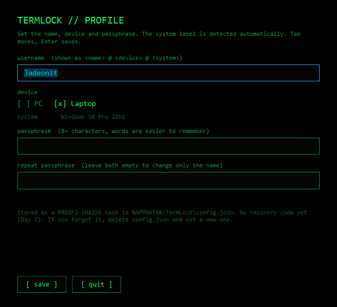

# TermLock

> A privacy curtain for Windows with a terminal soul.

TermLock does **not** replace your Windows password, does **not** encrypt your disk,
and does **not** lock the Windows session. It covers the desktop with a fullscreen
terminal when you step away, and only your passphrase brings it back.

That makes it a *privacy curtain*: perfect against a family member glancing at the
laptop, useless against someone who knows what they are doing. See
[docs/SECURITY.md](docs/SECURITY.md) for the honest version.

## Status

**v0.2 in progress — daily commits.**


*Current lock screen: full-body digit rain, live system stats and terminal art.*

### Works today

- fullscreen, borderless, topmost terminal curtain across the whole virtual desktop
- global hotkey `Ctrl+Alt+Shift+L`
- passphrase unlock (`PBKDF2-HMAC-SHA256`, 600 000 iterations, random salt)
- header prompt (`<name> @ <device> @ <Windows version>`, e.g. `Jadeonit @ Laptop @ Windows 10 Pro 22H2`); the SYSTEM block shows the account name and `Windows 10 Pro`
- keyboard layout badge `[EN]` / `[RU]` with `CAPS` and `CYR` warnings
- keyboard guard while locked: `Win`, `Alt+Tab`, `Alt+F4`, `Ctrl+Esc`, `PrintScreen`
- double-tap `Caps Lock` to summon the curtain
- live CPU / RAM / disk bars, Defender, firewall and Secure Boot checks
- attempt counter with a cooldown
- tray icon: lock / set profile / open config folder / exit
- autostart via `HKCU\...\Run` (no admin, no service, no driver)
- single instance, append-only log
- animated digit rain (glyph atlas + `WriteableBitmap`, 30 FPS)

### Planned

- watchdog process
- USB key unlock
- recovery code
- ntfy alerts on failed attempts (phone + watch)
- configurable action after 3 failed attempts (Shutdown by default)
- guest mode — postponed for now

See [ROADMAP.md](ROADMAP.md).

## Requirements

- Windows 10 or 11, x64
- .NET 9 Desktop Runtime for the framework-dependent build, or build from source

## Build

```powershell
git clone https://github.com/Jadeonit/termlock.git
cd termlock
dotnet build TermLock.sln -c Release
```

## Run

```powershell
# start hidden in the tray, press Ctrl+Alt+Shift+L to lock
dotnet run --project src/TermLock

# start and lock immediately
dotnet run --project src/TermLock -- --lock
```

On the first run TermLock asks for a display name, a device (PC or Laptop) and a
passphrase. The Windows label is detected automatically. The passphrase is stored
as a PBKDF2 hash in `%APPDATA%\TermLock\config.json` — never in plaintext.

## Set or change the profile

**First run.** Launch `TermLock.exe` from Explorer or a normal PowerShell window.
A black `TERMLOCK // PROFILE` window appears in the center of the screen:

1. Type the name shown on the curtain (for example `Jadeonit`).
2. Choose `[ ] PC` or `[ ] Laptop`.
   The system line below shows the detected Windows version.
3. Type a passphrase of 8 or more characters.
4. Press `Tab` (or `Enter`) to move to the second field.
5. Type the same passphrase again.
6. Press `Enter` (or click `[ save ]`).

The header renders `<name> @ <device> @ <Windows version>`, for example
`Jadeonit @ Laptop @ Windows 10 Pro 22H2`. The SYSTEM block below shows the
account name in `user` and the product name (`Windows 10 Pro`) in `os`.



**Later.** Right-click the tray icon → `Set profile...`, or run:

```powershell
TermLock.exe --setup
```

`--setup` always opens the dialog, even when a passphrase already exists. Use it
when TermLock is not running; the tray menu applies changes immediately.
Leave both passphrase fields empty to change only the name and label.

If you forget the passphrase, delete `%APPDATA%\TermLock\config.json` and run
`--setup` again. This is intentional: a curtain must never lock *you* out.

> If you launch TermLock from an IDE or agent terminal that lives on another
> virtual desktop, the window may open there and you will not see it. Launch it
> from Explorer or a normal PowerShell window instead.


## Publish

```powershell
# small exe, needs the .NET 9 Desktop Runtime
dotnet publish src/TermLock/TermLock.csproj -c Release -r win-x64 --self-contained false -o publish

# standalone exe, no runtime needed
dotnet publish src/TermLock/TermLock.csproj -c Release -r win-x64 --self-contained true -p:PublishSingleFile=true -o publish
```

## Autostart

```powershell
TermLock.exe --install     # add to HKCU Run
TermLock.exe --uninstall   # remove from HKCU Run
TermLock.exe --disable     # exit immediately (emergency switch)
TermLock.exe --setup       # set or change the profile
```

Run `--install` from the **published** exe. If you install from `dotnet run`, the
registry will point at the SDK host instead of TermLock.

## Hotkey

| Keys | Action |
|---|---|
| `Ctrl+Alt+Shift+L` | show the curtain |
| `Caps Lock` ×2 | show the curtain (when unlocked) |
| `Esc` | clear the input line (never unlocks) |
| `Ctrl+U` | clear the input line |
| `Enter` | check the passphrase |
| `Alt+Shift` | switch the Windows input language; the prompt shows `[EN]` / `[RU]` |

The prompt also shows `CAPS` when Caps Lock is on and `CYR` when the typed
passphrase contains Cyrillic characters. Both are warnings, not blocks.

While the curtain is visible it is topmost, covers every monitor, and swallows
`Win`, `Alt+Tab`, `Alt+F4`, `Ctrl+Esc` and `PrintScreen`. It does not block
`Ctrl+Alt+Del` — nothing user-mode can.

## Where things live

| Path | Purpose |
|---|---|
| `%APPDATA%\TermLock\config.json` | settings and passphrase hash |
| `%APPDATA%\TermLock\logs\termlock.log` | auth and lifecycle events |
| `HKCU\Software\Microsoft\Windows\CurrentVersion\Run\TermLock` | autostart entry |

## Reset / emergency

- Kill `TermLock` in Task Manager (the session is never locked, nothing breaks).
- Delete `%APPDATA%\TermLock\config.json` to forget the passphrase and set a new one.
- `TermLock.exe --uninstall` removes autostart.
- `TermLock.exe --disable` is a one-shot "do not start" flag for scripts.

These exits are intentional. TermLock is a curtain, not a lock: it must never be
able to lock *you* out of your own machine.

## Docs

- [docs/ARCHITECTURE.md](docs/ARCHITECTURE.md) — why an overlay, how the pieces fit
- [docs/CODE.md](docs/CODE.md) — walkthrough of the code (in Russian, for learning)
- [docs/MATRIX.md](docs/MATRIX.md) — how the matrix rain renderer works
- [docs/NTFY.md](docs/NTFY.md) — phone/watch notifications with ntfy (in Russian)
- [docs/SECURITY.md](docs/SECURITY.md) — threat model and honest limitations

## License

MIT — see [LICENSE](LICENSE).

---

## Кратко по-русски

TermLock — это «ширма» для ноутбука: по горячей клавише экран закрывается
терминалом, а открывается только кодовой фразой. Сессия Windows не блокируется,
поэтому серверы и удалённая работа продолжают жить. Это защита от любопытных
домашних, а не от взлома: диск не шифруется, пароль Windows не меняется.
Подробности — в [docs/SECURITY.md](docs/SECURITY.md).
